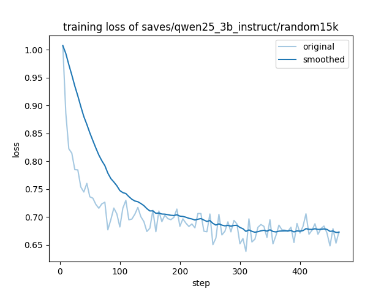

# Random15K — Dataset Selection, Training, and Evaluation

## Overview

Random15K is a uniformly random subset of 15,000 examples from the AceReason-1.1-SFT 100K dataset. It is the random-selection reference that the advanced strategies are compared against.

The subset was used to fully fine-tune Qwen2.5-3B-Instruct with supervised fine-tuning (SFT) in LLaMA-Factory.

- **Model:** [TML-Project1/qwen25-3b-random15k](https://huggingface.co/TML-Project1/qwen25-3b-random15k)
- **Dataset:** [TML-Project1/acereason-random15k](https://huggingface.co/datasets/TML-Project1/acereason-random15k)

## Dataset Selection

`scripts/make_random15k.py` downloads `data/acereason11_100k.json` from `redsgnaoh/acereason11_100k` and draws 15,000 examples with `random.sample` after `random.seed(42)`. No filtering, deduplication, or reformatting is applied. Records keep their `instruction`, `input`, `output`, `system`, and `extra_info` fields.

The dataset is registered in `LLaMA-Factory/data/dataset_info.json` as `random15k` with only `file_name`, so LLaMA-Factory reads `instruction`/`input`/`output` and does not use the per-example `system` field; training used the Qwen template's default system prompt. (`advanced15k_v5` maps `system` explicitly.)

## Training

Config: `LLaMA-Factory/examples/train_full/random15k.yaml`. Slurm script: `scripts/train_random15k.slurm`.

| Setting | Value |
|---|---|
| Base model | Qwen2.5-3B-Instruct |
| Fine-tuning | Full fine-tuning, DeepSpeed ZeRO-3 (no offload) |
| Template | `qwen` |
| Max sequence length (`cutoff_len`) | 4,096 |
| Epochs | 1 |
| Learning rate / scheduler / warmup | 5e-6 / cosine / 0.0 |
| Per-device batch × grad accumulation × GPUs | 1 × 8 × 4 = 32 |
| Steps | 469 |
| Precision | BF16 |
| Compute | ARC Falcon, 4× NVIDIA A30 (24 GB) |
| Final train loss | 0.6991 |
| Runtime | 7,193 s (2.0 h) |

`cutoff_len` and epochs were reduced from the README's 16,384 and 3 to fit the deadline and A30 memory. Solutions average roughly 6,000–7,000 tokens, so many training examples were truncated before their final `\boxed{}` answer.

Training logs: `results/random15k/` (`all_results.json`, `train_results.json`, `trainer_log.jsonl`, `training_loss.png`).



## Evaluation

`eval/eval_single.sh` with its defaults: qwen-instruct prompt, temperature 0.6, top-p 0.95, 8 samples, 32,768 max tokens, seed 0. **Acc** is pass@8 (a problem counts if any of the 8 samples is correct); **Pass@1** is the mean accuracy over the 8 samples.

| Benchmark | Problems | Correct (any of 8) | Acc (pass@8) | Pass@1 | Baseline Acc | Baseline Pass@1 |
|---|---:|---:|---:|---:|---:|---:|
| aime | 30 | 3 | 0.1000 | 0.0208 | 0.1667 | 0.0833 |
| amc | 40 | 26 | 0.6500 | 0.3125 | 0.7000 | 0.4188 |
| cn_math_2024 | 30 | 4 | 0.1333 | 0.0333 | 0.3667 | 0.1167 |
| gpqa | 198 | 81 | 0.4091 | 0.1048 | 0.7323 | 0.3037 |
| kaoyan | 199 | 116 | 0.5829 | 0.2129 | 0.5377 | 0.2180 |
| math | 500 | 416 | 0.8320 | 0.5823 | 0.8640 | 0.6570 |
| minerva | 272 | 116 | 0.4265 | 0.1797 | 0.4743 | 0.3015 |
| olympiadbench | 675 | pending | pending | pending | 0.4993 | 0.2811 |
| **mean of 7** | | | **0.4477** | **0.2066** | **0.5488** | **0.2999** |

Baseline numbers are from `results/baseline_qwen2.5-3b-instruct.md` (local run, vLLM 0.32.0); Random15K was evaluated on ARC Falcon, so sampling is not bit-identical between the two.

Random15K is below the baseline on six of seven benchmarks (kaoyan Acc is the exception). Pass@1 falls more than Acc, and GPQA Pass@1 (0.1048) is below the 0.25 expected from guessing on four options, which points to many responses without an extractable final answer. The truncated training examples are the most likely cause.

## Reproduce (ARC Falcon)

```bash
# 1. Build the dataset (trainenv, from the repository root)
python scripts/make_random15k.py

# 2. Train
sbatch scripts/train_random15k.slurm

# 3. Evaluate one benchmark (from eval/)
export CONDA_ENV=base PATH=$HOME/.local/bin:$PATH
export MODEL=$HOME/Project-Reasoning-SFT-LLM-Group5/LLaMA-Factory/saves/qwen25_3b_instruct/random15k
export OUTPUT_DIR=$HOME/Project-Reasoning-SFT-LLM-Group5/eval/outputs_random15k
sbatch --partition=a30_normal_q --qos=fal_a30_normal_short --gres=gpu:1 \
       --ntasks-per-node=1 --cpus-per-task=8 --mem=64G --time=1-00:00:00 \
       --job-name=ev_math --output=slurm_%x_%j.out eval_single.sh math
```

`CONDA_ENV=base` is needed on Falcon because `myenv` lacks `datasets`, and vLLM needs `ninja` on `PATH` to compile kernels.
